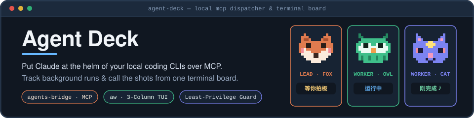
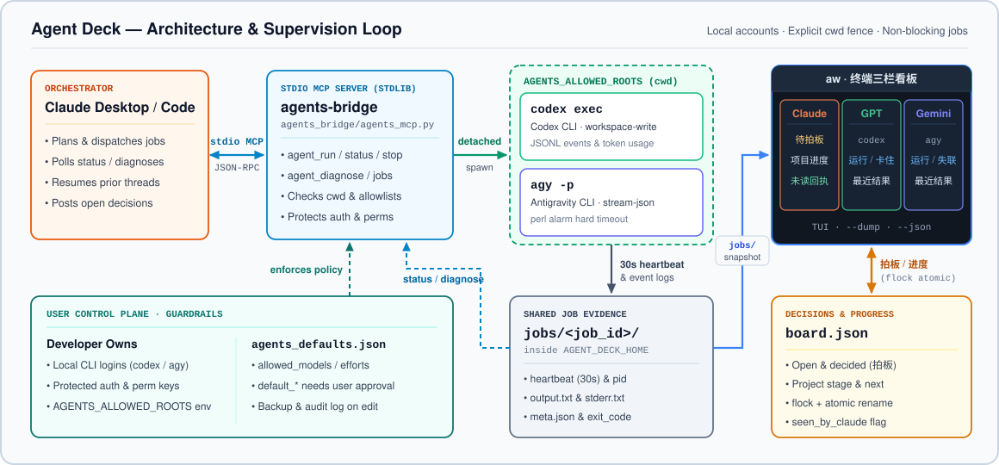
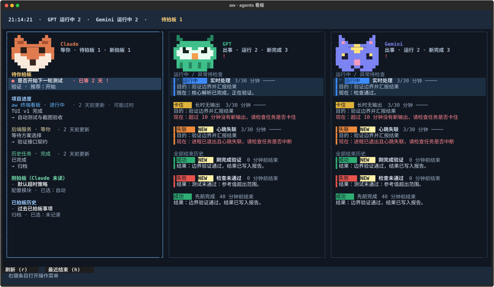
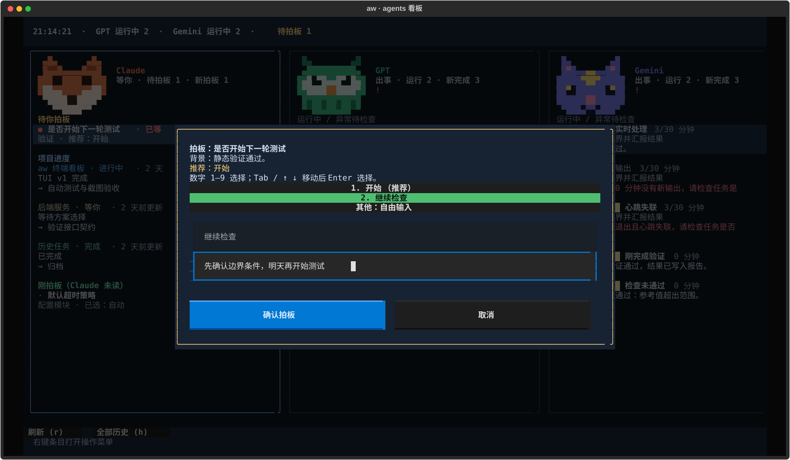
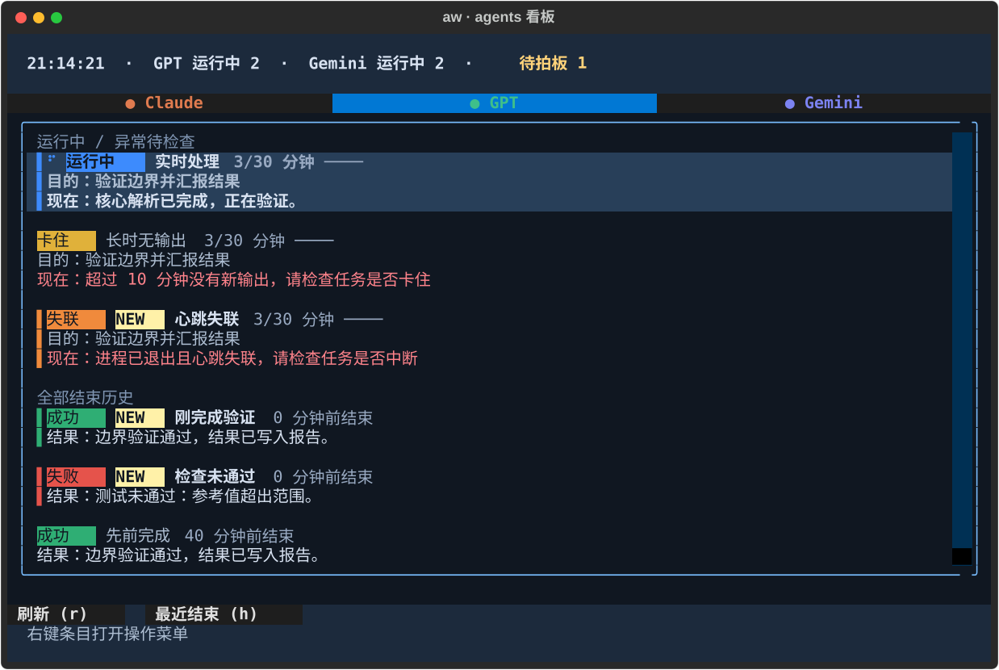

# Agent Deck



**Let Claude orchestrate your local Codex and Antigravity CLIs over MCP — while you watch every run and call the shots from one terminal board.**

[](LICENSE)


Running multiple AI coding CLIs side by side usually means juggling terminal tabs, babysitting long prompts, and handing an orchestrator far more shell access than it needs. **Agent Deck** turns Claude Desktop or Claude Code into a focused lead engineer that dispatches background jobs to your locally logged-in **Codex CLI** (`codex exec`) and **Antigravity CLI** (`agy -p`) through a stdlib-only stdio MCP server (`agents-bridge`). Each worker stays fenced inside your `AGENTS_ALLOWED_ROOTS` workspace under user-owned model, effort, and auth guardrails, running in detached sessions with heartbeats and hard timeouts so nothing blocks your main conversation. Meanwhile, **`aw`** gives you a live three-column terminal board — complete with animated pixel-pet headers — to watch background progress, spot stalled jobs, and sign off on pending decisions without leaving the terminal.

> 简介：让 Claude 作为总指挥，通过本地 MCP 服务（`agents-bridge`）把后台任务派发给本机已登录的 Codex CLI（`codex`）与 Antigravity CLI（`agy`），并用终端三栏看板 `aw`（配像素宠物状态栏头）实时盯进度、查异常、拍板待决事项。

## Highlights

- 🎯 **Claude Lead, Multi-CLI Workers** — Dispatch background tasks from Claude Desktop or Claude Code to local `codex exec` and `agy -p` sessions, resume prior job threads (`continue_job`), and inspect step-by-step progress and token usage.
- 🔒 **Least-Privilege Workspace Fencing** — Confine every worker's `cwd` to `AGENTS_ALLOWED_ROOTS` and run Codex in `workspace-write` sandbox mode instead of granting unrestricted shell access across your machine.
- 🛡️ **User-Owned Guardrails** — Keep CLI logins, permission settings, and `allowed_models` / `allowed_efforts` strictly user-managed; updating defaults via `agent_defaults_set` requires quoting your explicit approval and writes an audit trail.
- 📡 **Non-Blocking Supervision** — Run long jobs in detached process groups with 30-second heartbeats, hard `perl alarm` timeouts, automatic `running` / `stalled` / `died` liveness detection, and optional macOS desktop notifications.
- 🖥️ **Three-Column Terminal Board (`aw`)** — Track open decisions and project progress beside live GPT (`codex`) and Gemini (`antigravity`) queues, record or undo decisions with conflict-safe `fcntl.flock` atomic writes, or query headlessly via `--dump` and `--json`.
- 🦊 **Pixel-Pet Column Headers** — Original 14×12 half-block (`▀`/`▄`) pixel mascots (Fox, Owl, and Cat) sit atop the three columns and react to live queue states (`busy`, `idle`, `happy`, `error`).

### Architecture



### Terminal Board (`aw`)



| Interactive Decision Dialog (`Enter` / `d`) | Responsive Narrow Layout (`< 120` cols) |
| --- | --- |
|  |  |

## What It Is

Agent Deck consists of two lightweight components sharing a local state directory (`AGENT_DECK_HOME`):

1. **`agents-bridge` (`agents_bridge/agents_mcp.py`)**: A standard-library Python stdio MCP server. It lets Claude Desktop / Claude Code dispatch background jobs to locally installed and logged-in **Codex CLI** (`codex exec`) and **Antigravity CLI** (`agy -p`), inspect live progress (`agent_status`), diagnose stalled or exited runs (`agent_diagnose`), stop jobs (`agent_stop`), list token accounting (`agent_jobs`), and read/update user-approved defaults (`agent_defaults_get` / `agent_defaults_set`).
2. **`aw` (`aw/`)**: A Textual terminal dashboard (with a zero-dependency `--dump` / `--json` / `--decisions-unseen` CLI mode) showing three columns:
   - **Claude**: Open decisions waiting for user choice, project progress cards, and recently decided items awaiting Claude acknowledgment.
   - **GPT (`codex`)**: Running, stalled, died, and recently finished background jobs.
   - **Gemini (`antigravity`)**: Running, stalled, died, and recently finished background jobs.

## Why

- **Least privilege for the orchestrator**: Instead of granting the primary orchestrator unrestricted shell access across the entire machine, `agents-bridge` confines dispatched agents to an explicit `cwd` allowlist (`AGENTS_ALLOWED_ROOTS`) and runs Codex in `workspace-write` sandbox mode scoped to that `cwd`.
- **User-owned guardrails**: Auth, provider keys, CLI permissions (`PROTECTED` keys in `agent_config_set`), and model/effort allowlists (`allowed_models`, `allowed_efforts`) stay strictly user-managed. Changing default models via `agent_defaults_set` requires quoting the user's explicit approval.
- **Non-blocking oversight**: Long-running jobs run in detached process groups with a hard timeout (`perl alarm`), heartbeat files, and optional macOS desktop notifications, while `aw` provides fast read-only snapshots and conflict-safe atomic updates (`fcntl.flock` + atomic rename) for decisions and progress cards.

## Repository Layout

- `agents_bridge/`: Local stdio MCP server (`agents_mcp.py`, pure Python stdlib, Python >= 3.9).
- `aw/`: Terminal dashboard package (`core.py` is pure stdlib; `tui.py` and `pets.py` require `textual==6.5.0`).
- `bin/aw`: CLI launcher script resolving the local `.venv`.
- `install.sh`: Creates `.venv`, installs `textual==6.5.0`, and symlinks `~/.local/bin/aw`.
- `examples/`: Template configuration (`agents_defaults.example.json`) and sample board (`board.example.json`).
- `tests/`: Unit and async Textual Pilot integration tests.

## Installation

Requirements: Python >= 3.9 (`perl` is used for hard job timeouts in `agents_mcp.py`; `textual==6.5.0` is required only for the `aw` interactive TUI).

```sh
git clone https://github.com/xuzeliu80-ops/agent-deck.git
cd agent-deck
./install.sh
```

Ensure `~/.local/bin` is on your `PATH`. To initialize a sample state directory:

```sh
mkdir -p ~/.local/share/agent-deck/jobs
cp examples/board.example.json ~/.local/share/agent-deck/board.json
cp examples/agents_defaults.example.json ~/.local/share/agent-deck/agents_defaults.json
```

If you prefer a specific Python interpreter:

```sh
AW_PYTHON=/path/to/python3.12 ./install.sh
```

## Claude Desktop Configuration (`claude_desktop_config.json`)

Add `agents-bridge` under `mcpServers` using the path to your cloned repository (`<repo>` placeholder below):

```json
{
  "mcpServers": {
    "agents-bridge": {
      "command": "python3",
      "args": [
        "<repo>/agents_bridge/agents_mcp.py"
      ],
      "env": {
        "AGENT_DECK_HOME": "<home>/.local/share/agent-deck",
        "AGENTS_ALLOWED_ROOTS": "<home>/workspace"
      }
    }
  }
}
```

You can also run it as a module (`python3 -m agents_bridge`) when `<repo>` is on `PYTHONPATH` or installed via `pip install -e .`.

## Environment Variables

| Variable | Component | Default | Description |
| --- | --- | --- | --- |
| `AGENT_DECK_HOME` | `agents-bridge`, `aw` | `~/.local/share/agent-deck` | Shared root for `jobs/`, `logs/`, `board.json`, `aw_user_state.json`, and `agents_defaults.json`. |
| `AGENTS_ALLOWED_ROOTS` | `agents-bridge` | `$HOME` | Path-separated (`:` on POSIX) list of allowed workspace roots for `agent_run` `cwd`. |
| `AGENTS_JOB_DIR` | `agents-bridge` | `$AGENT_DECK_HOME/jobs` | Overrides where job directories are stored. |
| `AGENTS_DEFAULTS_FILE` | `agents-bridge` | `$AGENT_DECK_HOME/agents_defaults.json` | Overrides the default model/effort & allowlist file path. |
| `AW_JOBS_DIR` (or `AW_JOBS`) | `aw` | `$AGENT_DECK_HOME/jobs` | Overrides the jobs directory read by `aw`. |
| `AW_BOARD_FILE` (or `AW_BOARD`) | `aw` | `$AGENT_DECK_HOME/board.json` | Overrides the board JSON file path used by `aw`. |
| `AW_PYTHON` | `install.sh` | `python3` | Python >= 3.9 binary used to create `.venv`. |

## `aw` Usage

Launch the interactive TUI:

```sh
aw
```

CLI flags (headless modes import zero Textual modules and never write to disk):

```sh
aw --dump                      # Plain text snapshot
aw --dump --recent 5           # Text snapshot of the 5 most recent jobs
aw --json                      # Full JSON snapshot
aw --decisions-unseen          # Decided items with seen_by_claude == false
aw --jobs DIR --board FILE     # Override paths for a single invocation
aw --no-anim                   # Freeze header pixel sprites on frame 0
aw --no-notify                 # Disable macOS desktop notifications
```

### TUI Controls

- **Switch panes / items**: `Left` / `Right` / `Tab` / `Shift+Tab`, `Up` / `Down`, or click column tabs in narrow mode (`< 120` columns).
- **Left-click a card**: Selects the card; selecting a finished job marks it read (`NEW` badge clears and persists in `aw_user_state.json`).
- **Right-click a card or empty pane**: Opens context menu (decide, close, edit progress status/stage/next, archive/restore, hide finished jobs, or view archives).
- **Keyboard shortcuts**: `Enter` or `d` to decide/open details, `u` to undo a decision, `r` to refresh, `h` to toggle full history, `Ctrl+C` or double `Esc` (within 1.5 s) to quit.
- **macOS Terminal.app**: Enable **View -> Allow Mouse Reporting** in the menu bar for right-click support.

## Running Tests

```sh
PYTHONPATH=. ./.venv/bin/python -B -m unittest discover -s tests -v
```

## Security & Terms Notice

- **Restrict `AGENTS_ALLOWED_ROOTS`**: By default `AGENTS_ALLOWED_ROOTS` falls back to `$HOME`. In daily use, set it explicitly to only the project directory or workspace folders you want agents to touch.
- **Your own local accounts only**: `agents-bridge` invokes locally installed `codex` and `agy` binaries under your own authenticated sessions. Never share credentials, tokens, or private `AGENT_DECK_HOME` logs.
- **Terms of service**: You are responsible for complying with the terms of service, usage policies, and quota limits of each CLI provider you invoke.

## License

MIT — see [LICENSE](LICENSE).
